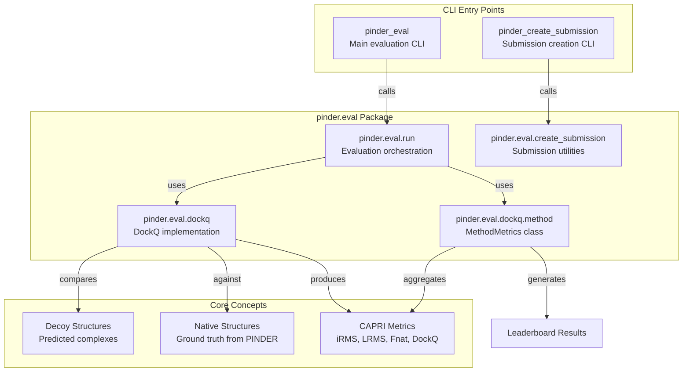
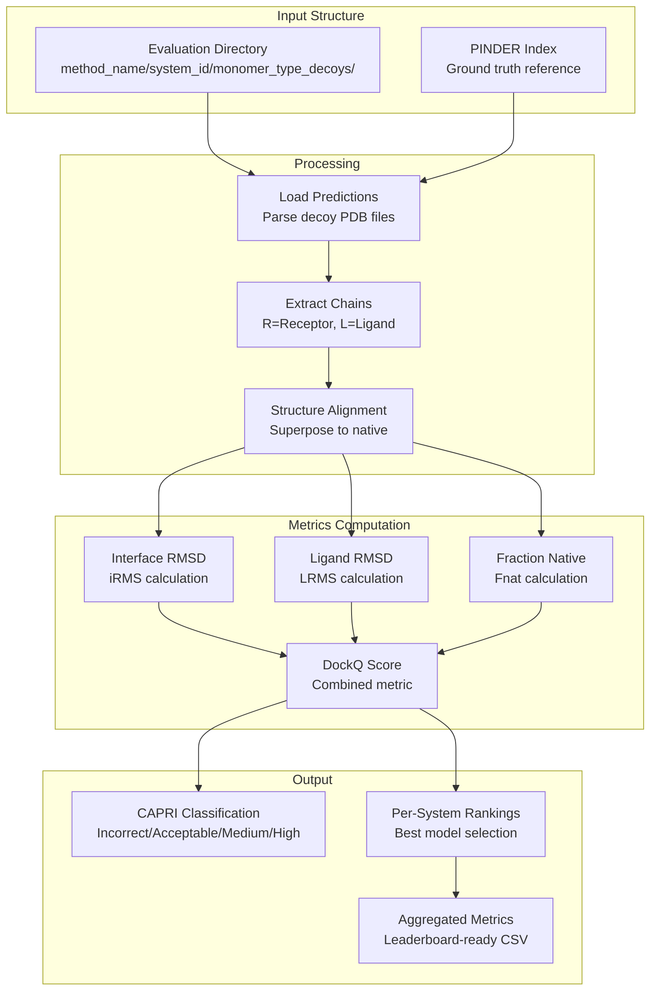
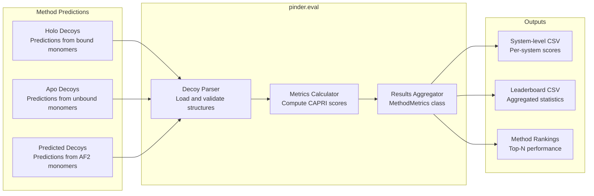

# pinder.eval

<details>
<summary>Relevant source files</summary>

The following files were used as context for generating this wiki page:

- [README.md](README.md)
- [pyproject.toml](pyproject.toml)

</details>


The `pinder.eval` package provides a complete evaluation harness for assessing protein-protein docking methods against the PINDER benchmark datasets. It implements community-standard CAPRI metrics and provides both programmatic APIs and command-line tools for computing docking quality scores.

For information about using the evaluation harness in practice, see [Evaluation](#6). For details on the CAPRI metrics themselves, see [Metrics](#6.2). For information about the benchmark test sets being evaluated against, see [Benchmark Test Sets](#6.3).

## Package Structure

The `pinder.eval` package is organized as a separate namespace package under the `pinder` umbrella. It contains modules for:

- **Evaluation orchestration**: Running evaluation pipelines over predicted structures
- **Metrics calculation**: Computing CAPRI metrics (DockQ, iRMS, LRMS, Fnat)
- **Method scoring**: Aggregating metrics across systems for leaderboard generation
- **Submission creation**: Utilities for preparing method predictions in the expected format



**Sources**: [README.md:300-380](), [pyproject.toml:41-42]()

## Core Components

### Evaluation Workflow

The evaluation system follows a structured workflow for processing method predictions and computing scores:



**Sources**: [README.md:300-327]()

### Directory Structure Requirements

The evaluation harness expects a specific directory organization for method predictions:

| Level | Component | Description |
|-------|-----------|-------------|
| Root | `eval_dir/` | Top-level evaluation directory |
| Method | `method_name/` | Subdirectory for each method being evaluated |
| System | `system_id/` | Subdirectory for each PINDER system (e.g., `1an1__A1_P00761--1an1__B1_P80424`) |
| Monomer Type | `holo_decoys/`, `apo_decoys/`, `predicted_decoys/` | Predictions grouped by input monomer type |
| Decoys | `model_<rank>.pdb` | Individual predicted structures with extractable rank |

**Sources**: [README.md:328-363]()

### Chain Naming Convention

All decoy models must follow a strict chain naming convention:

- **Chain R**: Receptor protein
- **Chain L**: Ligand protein

Each decoy PDB file must contain exactly two chains with these identifiers. The evaluation system uses these chain IDs to map predictions to ground truth structures.

**Sources**: [README.md:362]()

## CLI Tools

### pinder_eval

The main evaluation command-line interface for scoring method predictions:

```bash
pinder_eval --eval_dir <path> \
    --method_name <name> \
    --serial \
    --allow_missing \
    --custom_index <index_path> \
    --max_workers <n>
```

**Arguments**:

| Argument | Type | Required | Description |
|----------|------|----------|-------------|
| `--eval_dir`, `-f` | path | Yes | Path to evaluation directory containing method predictions |
| `--method_name`, `-m`, `-n` | string | No | Optional name for output CSV file |
| `--serial`, `-s` | flag | No | Disable parallel evaluation over systems (use single process) |
| `--allow_missing`, `-a` | flag | No | Allow missing systems without failing (applies penalty scores) |
| `--custom_index`, `-c` | path | No | Path to custom index with non-PINDER splits (must follow PINDER schema) |
| `--max_workers`, `-w` | int | No | Maximum number of processes for multiprocessing (default: all cores) |

**Entry Point**: [pyproject.toml:41]() - `pinder.eval.run:main`

**Sources**: [README.md:307-326]()

### pinder_create_submission

Utility for creating properly formatted submission directories:

```bash
pinder_create_submission [options]
```

**Entry Point**: [pyproject.toml:42]() - `pinder.eval.create_submission:main`

**Sources**: [pyproject.toml:42]()

## Metrics Implementation

### CAPRI Metrics

The evaluation harness implements the following community-standard CAPRI metrics:

| Metric | Name | Description | Range |
|--------|------|-------------|-------|
| iRMS | Interface RMSD | Root-mean-square deviation of interface residues | 0-100Å |
| LRMS | Ligand RMSD | RMSD of ligand after superposing receptor | 0-100Å |
| Fnat | Fraction of Native contacts | Proportion of native interface contacts recovered | 0-1 |
| DockQ | DockQ Score | Combined quality score derived from iRMS, LRMS, Fnat | 0-1 |
| CAPRI | CAPRI Classification | Qualitative assessment: Incorrect/Acceptable/Medium/High | categorical |

**Sources**: [README.md:304]()

### Missing System Penalty

To ensure fair comparison across methods, systems with missing predictions receive penalty scores:

```python
{
    "iRMS": 100.0,
    "LRMS": 100.0,
    "Fnat": 0.0,
    "DockQ": 0.0,
    "CAPRI": "Incorrect",
}
```

These penalty values are applied when a method fails to produce predictions for a system in the benchmark set. The `--allow_missing` flag controls whether missing systems cause evaluation to fail or are penalized.

**Sources**: [README.md:365-376]()

### Decoy Rank Extraction

The evaluation system extracts model ranking from decoy filenames using a regular expression pattern: `r"\d+(?=\D*$)"`. This pattern matches the last sequence of digits in the filename, allowing flexible naming schemes like:

- `model_1.pdb`, `model_2.pdb`, ... (simple ranking)
- `decoy_rank_001.pdb`, `decoy_rank_002.pdb`, ... (zero-padded ranking)
- `prediction_top1.pdb`, `prediction_top2.pdb`, ... (alternative naming)

**Sources**: [README.md:360]()

## Key Classes

### MethodMetrics

The `MethodMetrics` class aggregates per-system metrics into leaderboard-ready results. It is implemented in [src/pinder-eval/pinder/eval/dockq/method.py]() and handles:

- Loading evaluation results across all systems
- Computing summary statistics (mean, median, success rates)
- Generating leaderboard entries
- Handling missing predictions with penalty scores

**Sources**: [README.md:380]()

## Programmatic Usage

The evaluation harness can be used programmatically as an alternative to the CLI:

```python
from pinder.eval import evaluate_method

# Evaluate a method's predictions
results = evaluate_method(
    eval_dir="path/to/eval_dir",
    method_name="my_method",
    allow_missing=True,
    max_workers=8
)

# Results contain per-system metrics
for system_id, metrics in results.items():
    print(f"{system_id}: DockQ={metrics['DockQ']:.3f}")
```

**Note**: The exact API may vary. Refer to [pinder.eval.run]() for the current implementation details.

**Sources**: [README.md:378]()

## Evaluation Pipeline Integration



**Sources**: [README.md:288-298](), [README.md:300-380]()

## Test Set Compatibility

The evaluation harness supports all PINDER benchmark test sets:

| Test Set | Systems | Use Case |
|----------|---------|----------|
| PINDER-XL | 1,955 | Full benchmark evaluation |
| PINDER-S | 250 | Fast evaluation subset (diverse annotations) |
| PINDER-AF2 | 180 | AlphaFold2-deleaked subset for AF2-MM comparison |

Methods are evaluated separately on each test set, with results typically reported for all three benchmarks to allow comprehensive assessment across different evaluation scenarios.

**Sources**: [README.md:247-251]()

## Parallel Processing

The evaluation harness supports parallel processing of systems using Python's multiprocessing:

- **Default behavior**: Uses all available CPU cores
- **Custom workers**: Specify `--max_workers N` to limit parallelism
- **Serial mode**: Use `--serial` flag to disable multiprocessing (useful for debugging)

Parallel evaluation significantly speeds up scoring when evaluating methods on large test sets like PINDER-XL.

**Sources**: [README.md:324-325]()

## Custom Index Support

The evaluation harness can be used with custom dataset splits via the `--custom_index` option:

**Requirements**:
- Must follow PINDER index schema (same columns as standard index)
- Must define test holdout sets with `split` column
- Does not need to share the same systems as official PINDER splits

This feature enables evaluation on custom benchmark sets while leveraging the same metrics and infrastructure.

**Sources**: [README.md:322-323]()

---