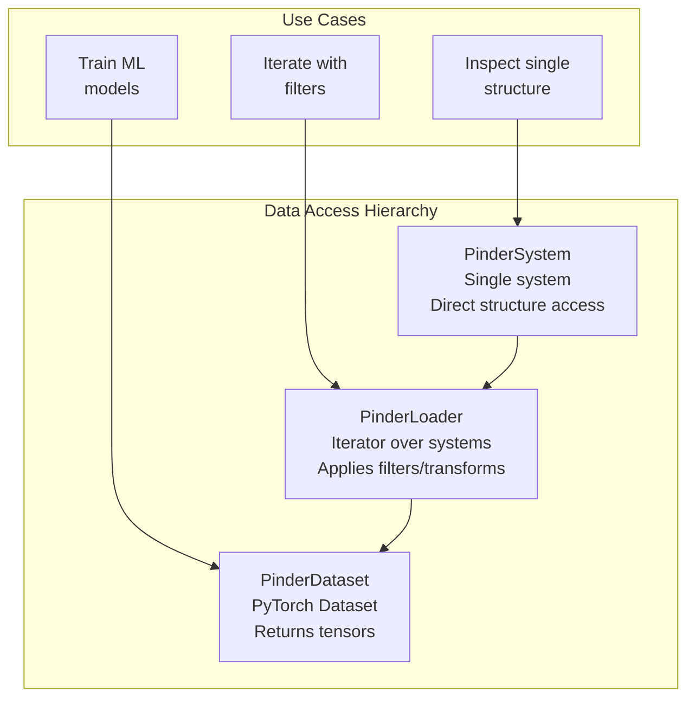
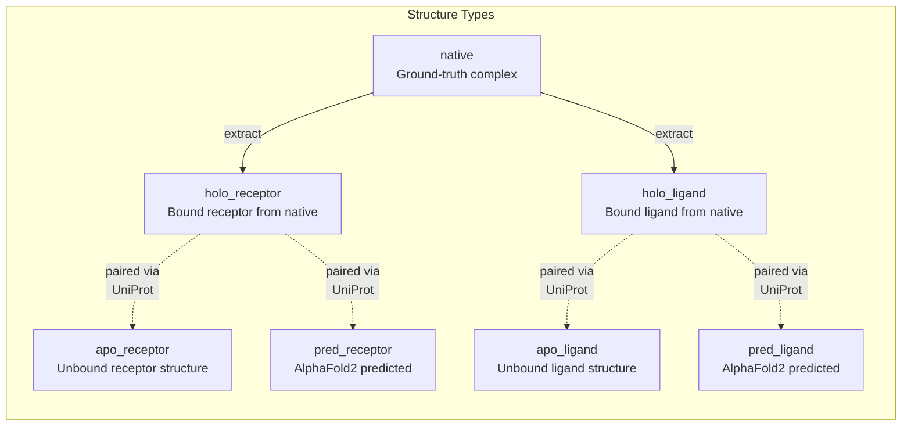
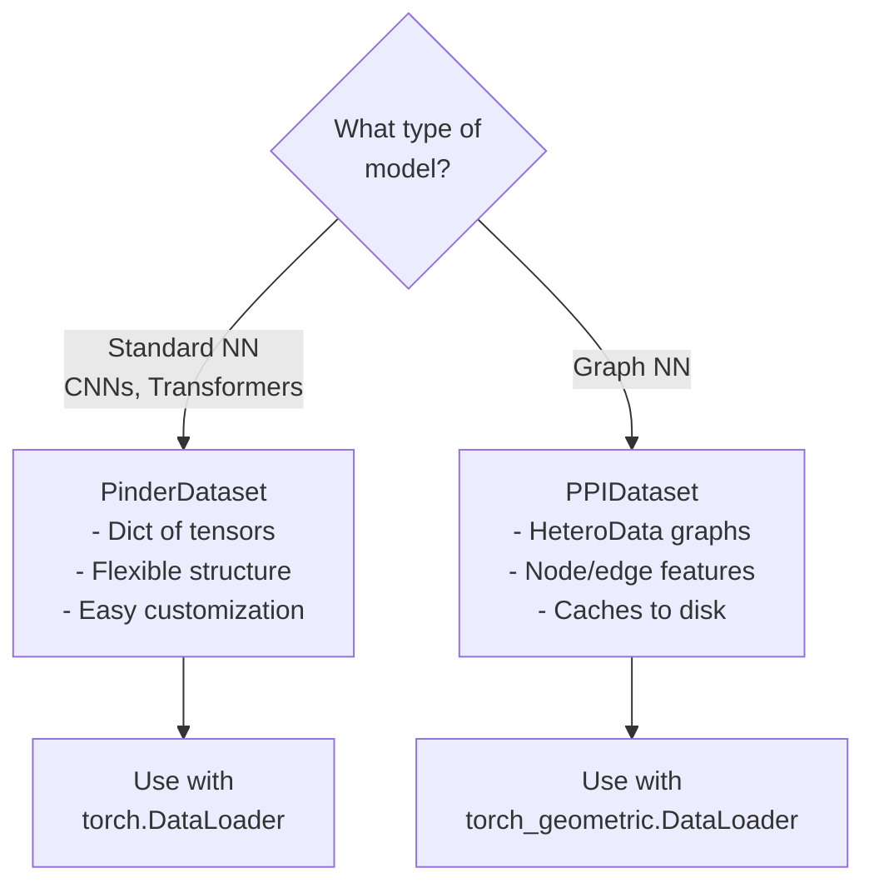
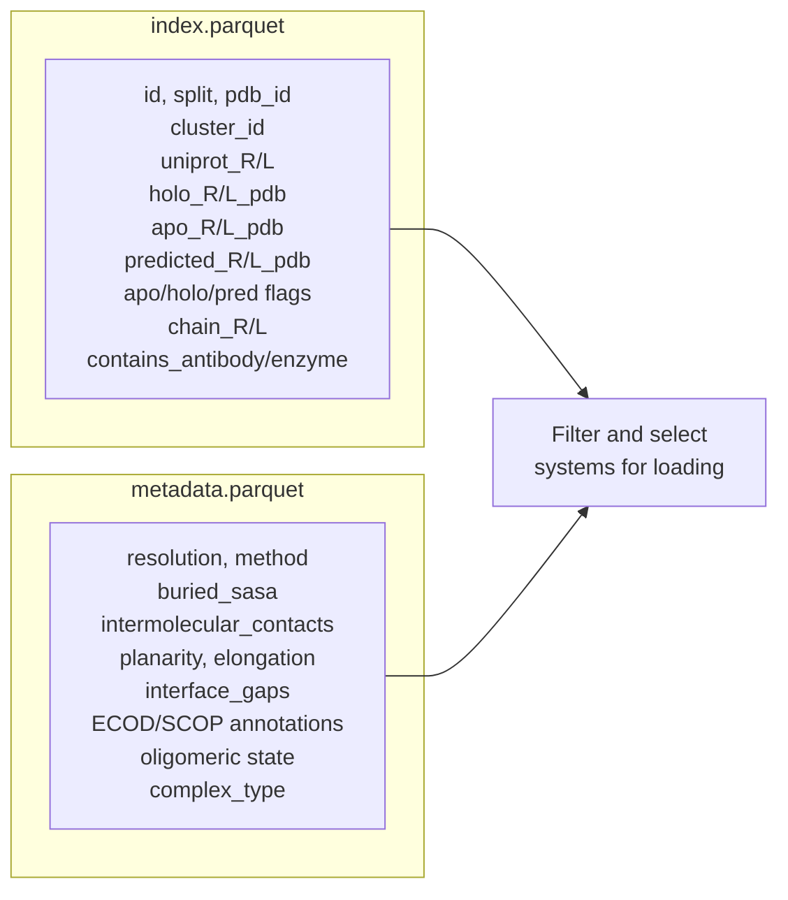
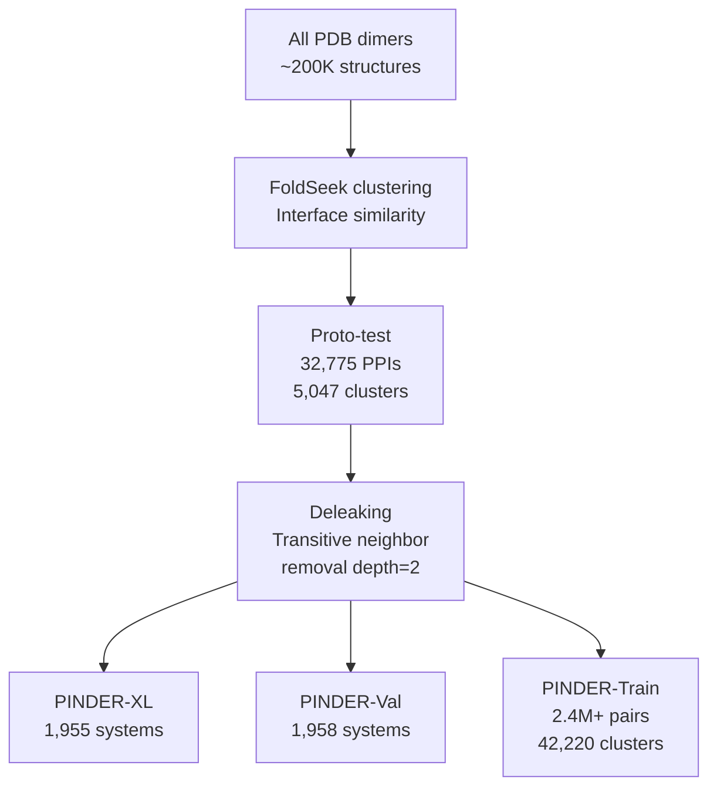

# Frequently Asked Questions

<details>
<summary>Relevant source files</summary>

The following files were used as context for generating this wiki page:

- [README.md](README.md)
- [examples/pinder-loader.ipynb](examples/pinder-loader.ipynb)

</details>


This document addresses common questions about using the PINDER dataset, troubleshooting issues, and optimizing performance. For detailed tutorials on specific features, see [Quick Start Guide](#2), [Core Data Structures](#3), and [Data Loading System](#4).

## Installation and Setup

### How do I install PINDER?

The basic installation requires only `pinder-core`:

```bash
pip install pinder
```

For additional functionality, install with extras:

```bash
# For evaluation capabilities
pip install pinder[eval]

# For all features
pip install pinder[all]
```

Sources: [README.md:44-118]()

### Why does fastpdb installation fail on my system?

`fastpdb` is a Rust-based dependency that requires pre-built wheels or the Rust toolchain. Pre-built wheels are available for:
- Linux with glibc≥2.34 (Debian 12, Ubuntu 22.04, RHEL 9+)
- MacOS Sierra (10.12) or newer
- Windows

If your platform doesn't match, install the Rust toolchain first:

```bash
curl --proto '=https' --tlsv1.2 -sSf https://sh.rustup.rs | sh
```

Then install pinder.

Sources: [README.md:24-42]()

### How do I install torch-cluster for graph neural networks?

`torch-cluster` is optional and only needed for graph-based workflows with `PPIDataset`. Installation depends on your PyTorch and CUDA versions:

```bash
# Replace ${TORCH} and ${CUDA} with your versions
pip install torch-cluster -f https://data.pyg.org/whl/torch-${TORCH}+${CUDA}.html
```

For Apple Silicon Macs, install from source:

```bash
pip install torch
pip install torch-cluster
```

Sources: [README.md:70-91]()

## Dataset Management

### Where is the dataset stored?

By default, PINDER stores data in `~/.local/share/pinder/<release>`. You can customize this with the `PINDER_BASE_DIR` environment variable:

```bash
export PINDER_BASE_DIR=~/my-custom-location/pinder
```

Check the current location:

```python
from pinder.core import get_pinder_location
print(get_pinder_location())
```

Sources: [README.md:123-142]()

### How much disk space do I need?

The complete dataset requires approximately 700GB:

| Component | Compressed | Unpacked |
|-----------|-----------|----------|
| pdbs.zip | 144GB | 672GB |
| test_set_pdbs.zip | 149MB | 705MB |
| mappings.zip | 6.8GB | 25GB |
| index.parquet | - | ~100MB |
| metadata.parquet | - | ~200MB |

Sources: [README.md:197-208]()

### Can I download only a subset of the data?

Yes. The index and metadata files can be used independently for exploration. Individual PDB files are downloaded on-demand by `PinderSystem` when accessed. You can also download specific splits:

```python
from pinder.core import PinderLoader

# Only test set will be downloaded as needed
loader = PinderLoader(split="test", subset="pinder_s")
```

Sources: [README.md:146-161](), [src/pinder-core/pinder/core/index/system.py]()

### How do I update to a new dataset version?

For index/metadata updates without structure changes:

```bash
pinder_update_index
```

For structure file updates:

```bash
pinder_sync_data
```

The current release version is `2024-02`.

Sources: [README.md:210-239]()

## Data Loading and Filtering

### What's the difference between PinderSystem, PinderLoader, and PinderDataset?



- **PinderSystem**: Load and inspect individual protein complexes with all associated structures (native, holo, apo, predicted)
- **PinderLoader**: Iterator that applies filters, transforms, and monomer selection strategies across multiple systems
- **PinderDataset**: PyTorch-compatible dataset that converts structures to tensors for training

Sources: [src/pinder-core/pinder/core/index/system.py](), [src/pinder-core/pinder/core/loader/loader.py](), [src/pinder-core/pinder/core/loader/dataset.py]()

### How do I filter systems by quality criteria?

PINDER provides three filter levels:

```python
from pinder.core import PinderLoader
from pinder.core.loader import filters

# System-level filters
base_filters = [
    filters.FilterByMissingHolo(),
    filters.FilterSubByContacts(min_contacts=5, radius=10.0),
    filters.FilterDetachedHolo(radius=12, max_components=2),
]

# Monomer-level filters
sub_filters = [
    filters.FilterSubByAtomTypes(min_atom_types=4),
    filters.FilterByHoloOverlap(min_overlap=5),
    filters.FilterByHoloSeqIdentity(min_sequence_identity=0.8),
]

# Structure-level filters
structure_filters = [
    filters.MinAtomTypesFilter(),
]

loader = PinderLoader(
    split="train",
    base_filters=base_filters,
    sub_filters=sub_filters,
    structure_filters=structure_filters,
)
```

Sources: [examples/pinder-loader.ipynb:438-477](), [src/pinder-core/pinder/core/loader/filters.py]()

### How do I filter by metadata annotations?

Use the `FilterMetadataFields` filter or pandas queries on the index/metadata:

```python
from pinder.core.loader import filters

# Method 1: Using FilterMetadataFields
base_filters = [
    filters.FilterMetadataFields(
        contains_antibody=('', False),
        resolution=('<=', 2.75),
        method=('!=', 'X-RAY DIFFRACTION'),
    ),
]

# Method 2: Query index directly
from pinder.core import get_index, PinderLoader

index = get_index()
filtered_ids = index.query(
    'split == "train" and chain1_neff > 10 and chain2_neff > 10'
).id.tolist()

loader = PinderLoader(ids=filtered_ids)
```

Sources: [README.md:626-667](), [src/pinder-core/pinder/core/loader/filters.py]()

## Monomer Selection and Structure Types

### What are holo, apo, and predicted monomers?



- **holo**: Monomers extracted from the native bound complex (always available)
- **apo**: Unbound monomers from separate PDB structures (available for ~17% of systems)
- **predicted**: AlphaFold2 predicted structures (available for ~25% of systems)

Sources: [README.md:398-406](), [examples/pinder-loader.ipynb:246-269]()

### How do I control which monomer types are used?

Use the `monomer_priority` parameter:

```python
from pinder.core.loader.dataset import PinderDataset

# Use only holo monomers
dataset = PinderDataset(split="train", monomer_priority="holo")

# Use only apo monomers (falls back to holo if unavailable)
dataset = PinderDataset(split="train", monomer_priority="apo", fallback_to_holo=True)

# Use only predicted monomers
dataset = PinderDataset(split="train", monomer_priority="pred")

# Randomly select same type for both receptor and ligand
dataset = PinderDataset(split="train", monomer_priority="random")

# Randomly select types independently for receptor and ligand
dataset = PinderDataset(split="train", monomer_priority="random_mixed")
```

Sources: [examples/pinder-loader.ipynb:811-837](), [src/pinder-core/pinder/core/loader/loader.py]()

### What does fallback_to_holo do?

When `fallback_to_holo=True` (default), if the requested monomer type (apo or predicted) is unavailable, the system will use the holo monomer instead. This allows training on all available systems while still incorporating unbound structures when possible.

When `fallback_to_holo=False`, systems without the requested monomer type will be skipped.

Sources: [examples/pinder-loader.ipynb:829-835](), [src/pinder-core/pinder/core/loader/loader.py]()

### How do I check which systems have apo or predicted structures?

Use boolean columns in the index:

```python
from pinder.core import get_index

index = get_index()

# Systems with both apo monomers
apo_both = index.query('apo_R and apo_L')

# Systems with at least one apo monomer
apo_any = index.query('apo_R or apo_L')

# Systems with predicted structures
pred_both = index.query('predicted_R and predicted_L')

# Systems with apo receptor and predicted ligand
mixed = index.query('apo_R and predicted_L')
```

Sources: [examples/pinder-loader.ipynb:262-269](), [README.md:529-566]()

## PyTorch Integration

### How do I create a PyTorch DataLoader?

```python
from pinder.core.loader.dataset import PinderDataset, get_torch_loader

# Create dataset
dataset = PinderDataset(
    split="train",
    monomer_priority="random_mixed",
)

# Create dataloader
dataloader = get_torch_loader(
    dataset,
    batch_size=2,
    shuffle=True,
    num_workers=4,
)

# Get a batch
batch = next(iter(dataloader))
# batch is a dict with keys: target_complex, feature_complex, id, sample_id, target_id
```

Sources: [examples/pinder-loader.ipynb:1687-1749](), [src/pinder-core/pinder/core/loader/dataset.py]()

### How do I use PyTorch Geometric with PINDER?

```python
from pinder.core.loader.dataset import PPIDataset, get_geo_loader
from pinder.core.loader.geodata import NodeRepresentation

# Define node types
nodes = {
    NodeRepresentation("atom"),
    NodeRepresentation("residue")
}

# Create dataset
dataset = PPIDataset(
    node_types=nodes,
    split="train",
    monomer1="holo_receptor",
    monomer2="holo_ligand",
)

# Create dataloader
loader = get_geo_loader(dataset, batch_size=32)

# Get a batch (returns HeteroData)
batch = next(iter(loader))
```

Sources: [examples/pinder-loader.ipynb:1762-1816](), [README.md:466-515]()

### What's the structure of a PinderDataset batch?

A batch is a dictionary with the following structure:

```python
{
    'target_complex': {
        'atom_coordinates': Tensor[batch, atoms, 3],
        'atom_types': Tensor[batch, atoms, 1],
        'element_types': Tensor[batch, atoms, 1],
        'residue_types': Tensor[batch, atoms, 1],
        'residue_coordinates': Tensor[batch, residues, 3],
        'residue_ids': Tensor[batch, atoms],
        'chain_ids': Tensor[batch, atoms],
    },
    'feature_complex': {
        # Same structure as target_complex
    },
    'id': List[str],  # PINDER system IDs
    'sample_id': List[str],  # Selected monomer IDs
    'target_id': List[str],  # Holo monomer IDs
}
```

Tensors are padded to the maximum length in the batch.

Sources: [examples/pinder-loader.ipynb:722-804](), [src/pinder-core/pinder/core/loader/dataset.py]()

### How does batching handle variable-sized structures?

PINDER uses padding to create uniform batch sizes. The `collate_batch` function pads tensors to the maximum dimensions in the batch:

```python
from pinder.core.loader.dataset import pad_and_stack

# Pad coordinates with value -100
coords_batch = pad_and_stack(
    [struct1.coords, struct2.coords],
    dim=0,
    value=-100
)
```

You can implement custom collation functions for different padding strategies.

Sources: [examples/pinder-loader.ipynb:2751-2872](), [src/pinder-core/pinder/core/loader/dataset.py]()

## Advanced Usage

### How do I implement custom transforms?

Transforms operate on `Structure` objects. Create a class inheriting from `StructureTransform`:

```python
from pinder.core.loader.transforms import StructureTransform
from pinder.core.loader.structure import Structure

class SelectAtomTypes(StructureTransform):
    def __init__(self, atom_types: list[str]):
        self.atom_types = atom_types
    
    def __call__(self, structure: Structure) -> Structure:
        mask = [atom in self.atom_types for atom in structure.atom_array.atom_name]
        structure.atom_array = structure.atom_array[mask]
        return structure

# Use in dataset
from pinder.core.loader.dataset import PinderDataset

dataset = PinderDataset(
    split="train",
    structure_transforms_feature=[SelectAtomTypes(["CA", "N", "C", "O"])],
)
```

Sources: [examples/pinder-loader.ipynb:782-803](), [src/pinder-core/pinder/core/loader/transforms.py]()

### How do I implement diversity sampling?

Use `torch.utils.data.WeightedRandomSampler` with inverse cluster size weights:

```python
from torch.utils.data import WeightedRandomSampler
import torch

def inverse_cluster_size_sampler(dataset):
    index = dataset.index
    cluster_counts = index["cluster_id"].value_counts()
    index = index.merge(
        cluster_counts.rename("cluster_count"),
        left_on="cluster_id",
        right_index=True
    )
    weights = 1.0 / torch.tensor(index.cluster_count.values)
    return WeightedRandomSampler(
        weights=weights,
        num_samples=len(cluster_counts),
        replacement=True,
    )

# Use with DataLoader
sampler = inverse_cluster_size_sampler(dataset)
loader = DataLoader(dataset, batch_size=32, sampler=sampler)
```

Sources: [examples/pinder-loader.ipynb:2513-2563](), [README.md:391]()

### How do I use alternative apo structures?

By default, PINDER uses the canonical apo structure (highest quality) stored in `apo_R_pdb` and `apo_L_pdb` columns. To access alternative apo structures:

```python
from pinder.core import PinderLoader

loader = PinderLoader(
    split="train",
    monomer_priority="apo",
    use_canonical_apo=False,  # Use alternative apo structures
)
```

Alternative apo structures are listed in the `apo_R_pdbs` and `apo_L_pdbs` columns (comma-separated).

Sources: [examples/pinder-loader.ipynb:836](), [README.md:548-551]()

### How do I pre-specify which monomers to use for each system?

Pass a dictionary mapping system IDs to monomer filenames:

```python
from pinder.core.loader.dataset import PinderDataset

monomer_spec = {
    "1df0__A1_Q07009--1df0__B1_Q64537": {
        "receptor": "1df0__A1_Q07009-R.pdb",
        "ligand": "6isu__A1_Q64537.pdb"  # Use apo ligand
    }
}

dataset = PinderDataset(
    split="train",
    pre_specified_monomers=monomer_spec,
)
```

Sources: [src/pinder-core/pinder/core/loader/loader.py](), [src/pinder-core/pinder/core/loader/dataset.py]()

## Evaluation

### How do I use the evaluation harness?

Organize predictions in the required directory structure:

```
eval_dir/
└── method_name/
    └── system_id/
        ├── holo_decoys/
        │   ├── model_1.pdb
        │   └── model_2.pdb
        ├── apo_decoys/
        │   └── model_1.pdb
        └── predicted_decoys/
            └── model_1.pdb
```

Then run evaluation:

```bash
pinder_eval --eval_dir eval_dir --method_name my_method
```

Or use the Python API:

```python
from pinder.eval.dockq import MethodMetrics

metrics = MethodMetrics(
    eval_dir="eval_dir",
    method_name="my_method",
)
results = metrics.compute_metrics()
```

Sources: [README.md:307-380](), [src/pinder-eval/pinder/eval/dockq/method.py]()

### What metrics are computed?

PINDER uses standard CAPRI metrics:

| Metric | Description | Range |
|--------|-------------|-------|
| iRMS | Interface RMSD | 0-100Å |
| LRMS | Ligand RMSD | 0-100Å |
| Fnat | Fraction of native contacts | 0-1 |
| DockQ | Composite quality score | 0-1 |
| CAPRI | Classification (Incorrect, Acceptable, Medium, High) | Categorical |

For missing predictions, penalty values are assigned: iRMS=100, LRMS=100, Fnat=0, DockQ=0.

Sources: [README.md:365-376](), [src/pinder-eval/pinder/eval/dockq/]()

### How can I use the evaluation harness outside of a PINDER context?

The evaluation functions work with any PDB files:

```python
from pinder.eval.dockq import calculate_dockq

# Compare predicted vs native structure
metrics = calculate_dockq(
    predicted_pdb="prediction.pdb",
    native_pdb="ground_truth.pdb",
    receptor_chain="R",
    ligand_chain="L",
)

print(f"DockQ: {metrics['DockQ']:.3f}")
print(f"iRMS: {metrics['iRMS']:.3f}")
```

Sources: [README.md:378](), [src/pinder-eval/pinder/eval/dockq/dockq.py]()

## Performance Optimization

### How can I speed up data loading?

1. **Use multiple workers**:
```python
loader = get_torch_loader(dataset, num_workers=4)
```

2. **Cache processed systems** (for `PPIDataset`):
```python
dataset = PPIDataset(
    split="train",
    node_types=nodes,
    use_cache=True,
    force_reload=False,
)
```

3. **Limit dataset size during development**:
```python
dataset = PPIDataset(split="train", limit_by=100)
```

4. **Use `fastpdb` engine** (default, faster than biotite):
```python
from pinder.core.loader.structure import Structure
struct = Structure("path.pdb", pdb_engine="fastpdb")
```

Sources: [examples/pinder-loader.ipynb:1808](), [src/pinder-core/pinder/core/loader/dataset.py](), [src/pinder-core/pinder/core/loader/structure.py]()

### How much memory does the dataset require?

Memory usage depends on your workflow:

- **PinderSystem** (single system): ~10-50MB per system
- **PinderDataset** (in-memory index only): ~500MB for full training set
- **PPIDataset** (cached): ~1-2GB for processed graph files
- **DataLoader** with batching: Depends on batch size and workers

The index and structures are loaded lazily, so memory footprint stays manageable even with large datasets.

Sources: [src/pinder-core/pinder/core/index/system.py](), [src/pinder-core/pinder/core/loader/dataset.py]()

### Should I use PinderDataset or PPIDataset?



- **PinderDataset**: For standard neural networks. Returns dictionaries of tensors. More flexible for custom featurization.
- **PPIDataset**: For graph neural networks. Returns `HeteroData` objects with separate node/edge types. Caches processed graphs to disk.

Sources: [examples/pinder-loader.ipynb:694-714](), [README.md:433-514]()

## Troubleshooting

### Why do I get "FileNotFoundError" when loading systems?

The PDB file may not be downloaded yet. PINDER downloads files on-demand from Google Cloud Storage:

```python
from pinder.core import PinderSystem

# This automatically downloads if not present
system = PinderSystem("1df0__A1_Q07009--1df0__B1_Q64537")
```

If download fails, check:
1. Internet connectivity
2. Google Cloud Storage access (no authentication needed)
3. Disk space availability

Sources: [src/pinder-core/pinder/core/index/system.py](), [src/pinder-core/pinder/core/utils/cloud.py]()

### Why are my filters removing all systems?

Check filter criteria are not too strict:

```python
from pinder.core import PinderLoader

loader = PinderLoader(
    split="train",
    base_filters=base_filters,
)

print(f"Systems passing filters: {len(loader)}")

# Try removing filters one at a time to identify the issue
for filt in base_filters:
    test_loader = PinderLoader(split="train", base_filters=[filt])
    print(f"{filt.__class__.__name__}: {len(test_loader)} systems")
```

Sources: [examples/pinder-loader.ipynb:583-600]()

### Why do I get "RuntimeError: stack expects each tensor to be equal size"?

This happens when batching variable-sized structures without padding. Use the provided collation function:

```python
from pinder.core.loader.dataset import collate_batch, get_torch_loader

loader = get_torch_loader(
    dataset,
    batch_size=2,
    collate_fn=collate_batch,  # Handles padding
)
```

Sources: [examples/pinder-loader.ipynb:2740-2872]()

### What does "crop_equal_monomer_shapes" do?

When comparing holo vs apo/predicted structures, they may have different residues resolved. Setting `crop_equal_monomer_shapes=True` (default) crops both structures to common atoms:

```python
dataset = PinderDataset(
    split="train",
    crop_equal_monomer_shapes=True,  # Ensures target and feature have same shape
)
```

This is essential for models that expect fixed input/output dimensions.

Sources: [examples/pinder-loader.ipynb:1599-1606](), [src/pinder-core/pinder/core/loader/loader.py]()

### How do I debug which monomers are selected?

Check the `sample_id` field in the batch:

```python
batch = next(iter(dataloader))

for i, (pinder_id, sample_id, target_id) in enumerate(
    zip(batch['id'], batch['sample_id'], batch['target_id'])
):
    print(f"System: {pinder_id}")
    print(f"  Target (holo): {target_id}")
    print(f"  Sample: {sample_id}")
```

The monomer filenames indicate the type (holo/apo/pred) used.

Sources: [examples/pinder-loader.ipynb:1566-1578]()

### Why does PPIDataset processing take so long?

`PPIDataset` converts structures to graphs and caches them to disk. First-time processing is slow but subsequent loads are fast:

```python
# First run: slow (processes all systems)
dataset = PPIDataset(split="train", force_reload=True)

# Subsequent runs: fast (loads from cache)
dataset = PPIDataset(split="train", force_reload=False)
```

Use `limit_by` for faster iteration during development:

```python
dataset = PPIDataset(split="train", limit_by=100)
```

Sources: [examples/pinder-loader.ipynb:1776-1815]()

## Data Organization

### What's in the index vs metadata?



- **index.parquet**: System identifiers, split assignments, monomer availability, cluster IDs (58 fields)
- **metadata.parquet**: Detailed structural properties, quality metrics, annotations (45+ fields)

Use index for basic filtering and system selection. Use metadata for quality-based filtering.

Sources: [README.md:172-176](), [README.md:529-624]()

### How are systems split into train/val/test?



Systems are clustered by interface similarity, then cluster representatives are selected for test/val sets with strict deleaking to prevent data leakage.

Sources: [README.md:733-778](), [README.md:245-261]()

### What's the difference between PINDER-XL, PINDER-S, and PINDER-AF2?

| Test Set | Size | Purpose |
|----------|------|---------|
| PINDER-XL | 1,955 | Full test set, includes all quality systems |
| PINDER-S | 250 | Fast subset for quick evaluation |
| PINDER-AF2 | 180 | Deleaked from AlphaFold-Multimer training data |

All are subsets of the same high-quality systems, just filtered for different use cases.

Sources: [README.md:245-251](), [README.md:783-785]()

## Miscellaneous

### Can I use PINDER for antibody-antigen docking?

Yes, but note that antibodies are included in the general dataset. Filter for them:

```python
index = get_index()

# Antibody-antigen systems
ab_systems = index.query('contains_antibody and contains_antigen')

# Exclude antibodies
no_ab_systems = index.query('not contains_antibody')
```

A dedicated `pinder-ab` benchmark is planned for future releases.

Sources: [README.md:564-566](), [README.md:683]()

### How do I cite PINDER?

When using PINDER in research, please cite the dataset and relevant tools. Citation information is available in the repository and will be updated with publication details.

Sources: [README.md:1-13]()

### What Python versions are supported?

PINDER supports Python 3.10, 3.11, and 3.12. Full test coverage is maintained for 3.10 and 3.11, with basic tests for 3.12.

Sources: [README.md:838-841](), [.github/workflows/pr.yaml]()

### Where can I get help?

- **Documentation**: See the [examples](https://github.com/pinder-org/pinder/tree/main/examples) directory for notebooks
- **Issues**: Report bugs or request features on [GitHub Issues](https://github.com/pinder-org/pinder/issues)
- **Code**: Browse the source at [github.com/pinder-org/pinder](https://github.com/pinder-org/pinder)

Sources: [README.md:803-870]()

---