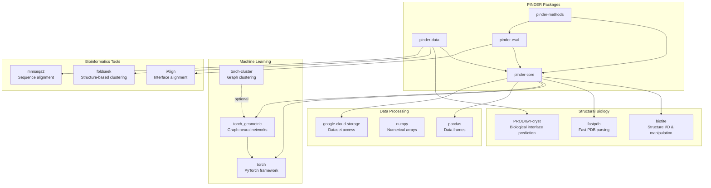
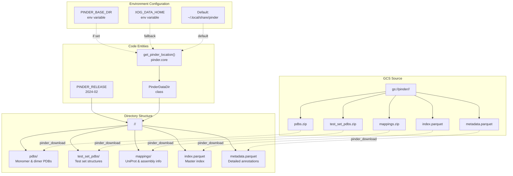

# Appendix

<details>
<summary>Relevant source files</summary>

The following files were used as context for generating this wiki page:

- [LICENSE](LICENSE)
- [README.md](README.md)

</details>


This appendix provides supplementary reference information for the PINDER project, including licensing details, citation information, external dependencies, dataset location specifications, and related resources. For information about the core functionality of PINDER, see [Overview](#1). For development practices and contribution guidelines, see [Development Guide](#7).

## License

PINDER is distributed under the Apache License, Version 2.0. This license permits commercial and non-commercial use, modification, and distribution of the software, provided that certain conditions are met.

### Apache License 2.0 Summary

The Apache License 2.0 provides the following permissions and requirements:

| Permission | Description |
|------------|-------------|
| Commercial use | The software and derivatives may be used for commercial purposes |
| Modification | The software may be modified |
| Distribution | The software may be distributed |
| Patent use | The license provides an express grant of patent rights from contributors |
| Private use | The software may be used and modified privately |

| Requirement | Description |
|-------------|-------------|
| License and copyright notice | A copy of the license and copyright notice must be included with the software |
| State changes | Changes made to the code must be documented |

| Limitation | Description |
|------------|-------------|
| Liability | The license includes a limitation of liability |
| Warranty | The software is provided without warranty |

The full text of the Apache License 2.0 is available in [LICENSE:1-202]().

**Sources:** [LICENSE:1-202](), [README.md:9-10]()

## Citation

When using PINDER in academic work or publications, please cite the dataset and software appropriately. The PINDER project includes the dataset itself (hosted at `gs://pinder` on Google Cloud Storage) and the software packages for accessing and processing it.

### Dataset Information

| Property | Value |
|----------|-------|
| Dataset Name | PINDER - Protein INteraction Dataset and Evaluation Resource |
| Current Version | 2024-02 |
| Size | ~700 GB |
| Storage Location | Google Cloud Storage bucket `gs://pinder` |
| Release Date | January 29, 2024 (RCSB snapshot date) |

### Software Package

| Property | Value |
|----------|-------|
| Package Name | pinder |
| PyPI URL | https://pypi.org/project/pinder/ |
| GitHub Repository | https://github.com/pinder-org/pinder |
| License | Apache License 2.0 |
| Versioning Scheme | Semantic Versioning (SemVer) |

**Sources:** [README.md:1-19](), [README.md:142-144](), [README.md:792-801]()

## External Dependencies

PINDER relies on several external libraries and tools for structural biology computations, machine learning, and data processing. The following diagram shows the dependency structure and how they integrate with PINDER packages.

### Dependency Architecture



**Sources:** [README.md:25-99]()

### Core Dependencies

| Dependency | Purpose | License | Installation Notes |
|------------|---------|---------|-------------------|
| biotite | Structure file I/O and atomic operations | BSD-3-Clause | Required for pinder-core |
| fastpdb | Accelerated PDB file parsing | MIT | Requires Rust toolchain if building from source |
| torch | Machine learning framework | BSD-style | Required for pinder-core |
| torch_geometric | Graph neural network library | MIT | Required for pinder-core |
| pandas | Data frame operations for index/metadata | BSD-3-Clause | Required for pinder-core |
| google-cloud-storage | Dataset download from GCS | Apache 2.0 | Required for pinder-core |

### Optional Dependencies

| Dependency | Purpose | Installation Command | Notes |
|------------|---------|---------------------|-------|
| torch-cluster | Graph clustering for PPIDataset | `pip install torch-cluster -f https://data.pyg.org/whl/torch-${TORCH}+${CUDA}.html` | Must specify PyTorch and CUDA versions |
| PRODIGY-cryst | Biological interface prediction | `pip install git+https://github.com/yusuf1759/prodigy-cryst.git` | Required for pinder-data only |
| foldseek | Structure-based clustering | System installation required | Used in data generation pipeline |
| mmseqs2 | Sequence alignment | System installation required | Used in data generation pipeline |
| iAlign | Interface alignment | System installation required | Used for deleaking and evaluation |

**Sources:** [README.md:25-99]()

### Platform-Specific Requirements

The `fastpdb` dependency requires special consideration based on platform:

**Pre-built Wheels Available:**
- Linux with glibc >= 2.34 (Debian 12, Ubuntu 22.04, RHEL 9)
- MacOS Sierra (10.12) or newer
- Windows

**Building from Source:**
If pre-built wheels are unavailable, install the Rust toolchain before installing PINDER:
```bash
curl --proto '=https' --tlsv1.2 -sSf https://sh.rustup.rs | sh
```

**Sources:** [README.md:25-42]()

## Dataset Location and Access

The PINDER dataset is stored on Google Cloud Storage and accessed through environment variables and utility functions in the codebase. The following diagram maps the conceptual dataset structure to actual code entities.

### Dataset Storage Structure Mapping



**Sources:** [README.md:122-140](), [README.md:162-193]()

### Location Configuration

The dataset location is determined by the following priority order:

1. `PINDER_BASE_DIR` environment variable (if set)
2. `XDG_DATA_HOME` environment variable (if set)
3. Default location: `~/.local/share/pinder`

The base directory refers to the path up to but not including the release version. The complete path structure is:
```
<base_dir>/<release_version>/
```

For example, with the default base and current release:
```
~/.local/share/pinder/2024-02/
```

**Checking Current Location:**
```python
from pinder.core import get_pinder_location
location = get_pinder_location()
```

**Setting Custom Location:**
```bash
export PINDER_BASE_DIR=~/my-custom-location-for-pinder/pinder
```

**Sources:** [README.md:127-140]()

### Dataset Files and Sizes

The complete dataset consists of the following files:

| File/Directory | Compressed Size | Unpacked Size | Description |
|----------------|----------------|---------------|-------------|
| pdbs.zip | 144 GB | 672 GB | Monomer and dimer PDB structures |
| test_set_pdbs.zip | 149 MB | 705 MB | Test set structures |
| mappings.zip | 6.8 GB | 25 GB | UniProt mappings and assembly information |
| index.parquet | N/A | ~100 MB | Master index with 2.4M+ entries |
| metadata.parquet | N/A | ~200 MB | Detailed metadata with 45+ annotation fields |
| **Total** | **~151 GB** | **~698 GB** | Complete dataset |

**Sources:** [README.md:196-208]()

### Download Commands

**Using Python API (Recommended):**
```bash
pinder_download --pinder_base_dir <path> --pinder_release 2024-02
```

**Manual Download via gsutil:**
```bash
export PINDER_RELEASE=2024-02
export PINDER_ROOT=pinder/$PINDER_RELEASE
gsutil -m cp gs://$PINDER_ROOT/pdbs.zip $XDG_DATA_HOME/$PINDER_ROOT/
gsutil -m cp gs://$PINDER_ROOT/test_set_pdbs.zip $XDG_DATA_HOME/$PINDER_ROOT/
gsutil -m cp gs://$PINDER_ROOT/mappings.zip $XDG_DATA_HOME/$PINDER_ROOT/
gsutil -m cp gs://$PINDER_ROOT/index.parquet $XDG_DATA_HOME/$PINDER_ROOT/
gsutil -m cp gs://$PINDER_ROOT/metadata.parquet $XDG_DATA_HOME/$PINDER_ROOT/
```

**Sources:** [README.md:146-196]()

### Update Commands

**Update Index/Metadata:**
```bash
pinder_update_index --pinder_release 2024-02
```

**Sync Structural Data:**
```bash
pinder_sync_data --pinder_release 2024-02
```

**Sources:** [README.md:210-239]()

## Related Resources

### External Data Sources

| Resource | URL | Purpose | Access Method |
|----------|-----|---------|---------------|
| RCSB PDB | https://www.rcsb.org/ | Source of protein structures | RCSB NextGen rsync server |
| AlphaFold Database (AFDB) | https://alphafold.ebi.ac.uk/ | Predicted protein structures | Direct download |
| UniProt | https://www.uniprot.org/ | Protein sequence database | API access |
| Pfam | http://pfam.xfam.org/ | Protein family database | RCSB GraphQL API |
| ECOD | http://prodata.swmed.edu/ecod/ | Evolutionary classification | RCSB GraphQL API |
| SCOP | https://scop.mrc-lmb.cam.ac.uk/ | Structural classification | RCSB GraphQL API |
| CATH | https://www.cathdb.info/ | Protein structure classification | RCSB GraphQL API |
| SAbDab | http://opig.stats.ox.ac.uk/webapps/sabdab/ | Antibody structure database | Used for antibody annotation |

**Sources:** [README.md:704-709](), [README.md:710-724]()

### Bioinformatics Tools

The PINDER pipeline and evaluation harness use the following external bioinformatics tools:

| Tool | Purpose | Reference | Installation |
|------|---------|-----------|--------------|
| FoldSeek | Structure-based protein clustering | Barrio-Hernandez et al. (2023) | System package or conda |
| MMseqs2 | Sequence database searching and clustering | Steinegger & Söding (2017) | System package or conda |
| iAlign | Interface structure alignment | Gao & Skolnick (2010) | System package |
| PRODIGY-cryst | Biological interface prediction | Rodrigues et al. (2016) | pip install from GitHub |

**Sources:** [README.md:95-99](), [README.md:733-745]()

### Documentation Resources

| Resource | Location | Description |
|----------|----------|-------------|
| GitHub Repository | https://github.com/pinder-org/pinder | Source code and issue tracking |
| PyPI Package | https://pypi.org/project/pinder/ | Python package distribution |
| API Documentation | gh-pages branch | Comprehensive API reference |
| Example Notebooks | examples/ directory | Jupyter notebooks demonstrating usage |
| FAQ | faq.md | Frequently asked questions |
| Limitations | limitations.md | Known limitations and caveats |
| Data Changelog | changelog_data.md | Dataset version history |

**Sources:** [README.md:803-817]()

## Version Information

PINDER uses independent versioning for the dataset and the software packages.

### Dataset Versioning

The dataset follows a `YYYY-MM` versioning scheme with releases expected at most monthly:

| Release | Date | Description | Status |
|---------|------|-------------|--------|
| 2024-02 | January 29, 2024 | Initial public release | Current |

Dataset updates are classified into two categories:

**Minor Updates:**
- Changes to index or metadata fields
- Addition or modification of structures assigned to training set
- Do not require reclustering
- Do not invalidate test set
- Methods do not need to re-evaluate

**Major Updates:**
- Addition of structures requiring reclustering
- Reassignment of structures to train/val/test splits
- Invalidate leaderboard results
- Require re-evaluation of methods
- Expected at most annually

**Sources:** [README.md:788-801]()

### Software Versioning

The PINDER software packages use Semantic Versioning (SemVer) with the format `MAJOR.MINOR.PATCH`:

- **MAJOR:** Incompatible API changes
- **MINOR:** Backward-compatible functionality additions
- **PATCH:** Backward-compatible bug fixes

Version information is managed through [version.sh]() and automated via GitHub Actions workflows.

**Sources:** [README.md:800-801]()

### Changelog Locations

Dataset changes are documented in [changelog_data.md](), which tracks:
- Structural file modifications
- Index and metadata updates
- Addition or removal of systems
- Test set composition changes

Software changes are documented through:
- Git commit history
- GitHub release notes
- PyPI release descriptions

**Sources:** [README.md:144](), [README.md:226]()

## Contributing

PINDER is a community effort that encourages contributions from the research community.

### Contribution Types

The project welcomes the following types of contributions:

| Contribution Type | Description | Location |
|------------------|-------------|----------|
| Bug reports | Issues with dataset or software | GitHub Issues |
| Feature requests | New functionality proposals | GitHub Issues |
| Code contributions | Bug fixes, new features | Pull Requests |
| Dataset improvements | Quality annotations, new pairings | GitHub Discussions |
| Documentation | Improvements to guides and examples | Pull Requests |
| Method implementations | Reference docking algorithms | pinder-methods package |

### Development Workflow

Contributors should follow the development guidelines outlined in [Development Guide](#7), which includes:

- Setting up the development environment
- Installing pre-commit hooks for code quality
- Running the test suite with tox
- Adhering to code style guidelines (ruff linting)
- Maintaining test coverage requirements

**Sources:** [README.md:867-870]()

### Code Quality Requirements

All contributions must meet the following quality standards:

| Requirement | Tool | Threshold |
|-------------|------|-----------|
| Linting | ruff | All checks must pass |
| Type checking | mypy | All type errors must be resolved |
| Test coverage | pytest + codecov | 75% project, 50% patch minimum |
| Python versions | tox | Must pass tests on Python 3.10, 3.11, 3.12 |

The CI/CD pipeline automatically validates these requirements on all pull requests.

**Sources:** [README.md:849-865]()

### Contact and Community

| Resource | Purpose | Link |
|----------|---------|------|
| GitHub Issues | Bug reports and feature requests | https://github.com/pinder-org/pinder/issues |
| GitHub Discussions | General questions and discussions | https://github.com/pinder-org/pinder/discussions |
| Pull Requests | Code contributions | https://github.com/pinder-org/pinder/pulls |

**Sources:** [README.md:867-870]()

## Future Roadmap

The PINDER project has identified several areas for future development and enhancement:

### Planned Features

| Feature | Description | Priority |
|---------|-------------|----------|
| Higher-order oligomers | Expansion beyond dimers to multi-chain complexes | High |
| Homologous apo pairing | Improved apo structure matching via Foldseek/MMseqs2 | High |
| Rosetta-relaxed structures | Energy-minimized unbound structures for evaluation | Medium |
| Reference-free metrics | VoroMQA, PISA quality assessment tools | Medium |
| Confirmed negative pairs | Experimentally validated non-interacting pairs | Medium |
| Antibody benchmark | Specialized test set for antibody-antigen docking | Medium |
| Contact-conditioned benchmarks | Evaluation with partial contact information | Low |
| Multimeric restraints | Additional information for training on multi-chain systems | Low |
| PyTorch Lightning integration | Improved abstractions for data loaders | Low |

**Sources:** [README.md:672-687]()

### Known Limitations

The project documentation includes a detailed discussion of current limitations in [limitations.md](), which addresses:

- Focus on dimers only
- Single reference conformation bias
- Dataset bias towards homodimers
- Apo pairing methodology
- Alignment approach limitations

Contributors interested in addressing these limitations are encouraged to engage with the development team.

**Sources:** [README.md:672-676]()